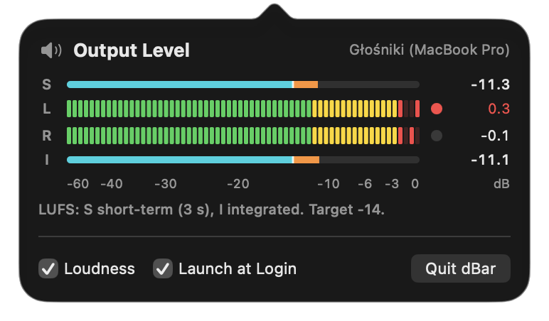

# dBar

A macOS menu bar app that shows a real-time stereo level meter for everything your Mac is playing.

<p align="center"></p>

Click the dBar icon (two rows of level segments) in the menu bar to open the meter:

- **L / R bars**: peak level in dBFS (IEC 60268-18 scale). Green is below −12 dB, yellow is −12 to −3 dB, red is above −3 dB.
- **Peak hold**: a single lit segment marks the recent peak and falls back on its own. The number on the right is the highest peak since the last reset, in dB.
- **Clip indicator**: latches red when a channel reaches 0 dBFS.
- **Loudness** (optional, turn on with the *Loudness* checkbox): short-term (S, last 3 s) and integrated (I) loudness in LUFS, measured per ITU-R BS.1770, as thin bars above and below the peak bars. A marker shows the −14 LUFS target most streaming services normalize to, and the bar turns orange past it. Tick *Keep measuring when closed* to let integrated loudness keep adding up after you close the meter; macOS then shows its recording indicator until you quit dBar or turn the option off.
- **Reset**: click any meter row to reset the peaks and clip indicators of both channels and start integrated loudness over.
- **Launch at Login**: starts dBar when you log in. It uses `SMAppService`, so it appears under System Settings › General › Login Items. Turn it on from the copy of the app you'll keep using, ideally one in `/Applications`.

## Download

Get the latest version from [Releases](https://github.com/tosiabunio/dBar/releases/latest). dBar needs macOS 14.2 or later and runs on Apple silicon and Intel Macs.

Releases aren't notarized by Apple, so macOS blocks dBar the first time you open it:

1. Download the `.zip`, unzip it, and move **dBar.app** to Applications.
2. Open dBar. When macOS says it can't verify the app, click **Done**.
3. In **System Settings › Privacy & Security**, scroll down to the message about dBar and click **Open Anyway**, then confirm.
4. Click the dBar icon in the menu bar. When macOS asks, allow dBar to capture system audio.

## Build from source

You need Xcode 26 or later (the app icon is an Icon Composer file). Open `dBar.xcodeproj` and press Run, or build from the terminal:

```sh
xcodebuild -project dBar.xcodeproj -target dBar -configuration Release build SYMROOT=$PWD/build
open build/Release/dBar.app
```

## Permission

The first time you open the meter, macOS asks for permission to capture system audio. If you denied it, or the meter stays silent while audio is playing, enable dBar under
**System Settings › Privacy & Security › Screen & System Audio Recording** (in the *System Audio Recording Only* section).

The build is ad-hoc signed ("Sign to Run Locally"). macOS may ask for permission again after a rebuild. To avoid that, set your development team under *Signing & Capabilities*.

## How it works

- `SystemAudioTap` creates a global stereo-mixdown process tap (`CATapDescription(stereoGlobalTapButExcludeProcesses:)`) and wraps it in a private aggregate device. The aggregate's IO callback measures per-channel peaks with vDSP.
- `LevelMeterModel` drains those peaks 60 times a second and applies meter ballistics: instant attack, 24 dB/s release, 1.5 s peak hold.
- `LoudnessAnalyzer` applies BS.1770 K-weighting on the IO thread and emits 100 ms blocks of power. `LoudnessMeter` turns them into short-term loudness and gated integrated loudness (−70 LUFS absolute gate, −10 LU relative gate). It matches the EBU Tech 3341 reference cases within 0.1 LU.
- Per-app volume mixers that play other apps' audio back themselves (currently FineTune) are left out of the tap. Otherwise that audio would be counted twice and read about 6 dB too high.
- Capture runs only while the popover is open, so the app uses no CPU and shows no recording indicator otherwise. The exception is *Keep measuring when closed*: capture then carries on after the popover closes (from the first time you open it), refreshing 10 times a second instead of 60.

The meter shows the digital signal apps send to the output, measured before the system volume control. Changing the volume slider does not move the bars.

## License

[BSD Zero Clause License (0BSD)](LICENSE). You can use, copy, modify and distribute dBar for any purpose, with or without credit.
